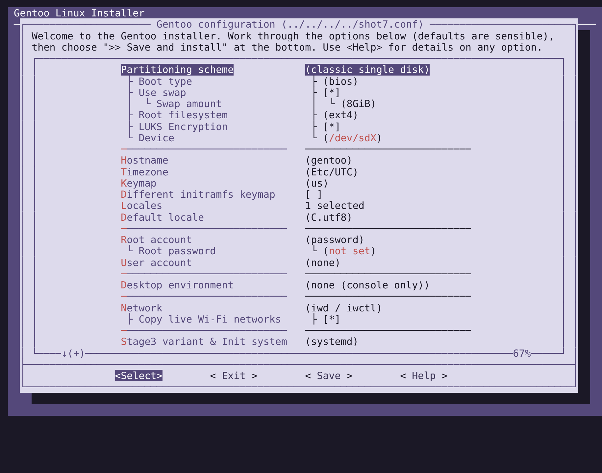

## Gentoo installer (fork of oddlama/gentoo-install)

A guided installer for a **real, handbook-style Gentoo system**: pick options in a Gentoo-themed
menu, press *Save and install*, and get a bootable machine with users, networking and (optionally)
a desktop. Works with systemd or OpenRC, EFI (recommended) or legacy BIOS, ext4/btrfs/ZFS,
LUKS and mdraid.

### What is different from upstream

- **Gentoo-themed TUI** (purple/lavender, also recolors the Linux console palette; disable with `GENTOO_INSTALL_NO_THEME=1`).
- **Accounts**: a regular user (wheel/audio/video/... groups, optional sudo) and a root account that is
  set, locked (sudo only) or asked for during install. Passwords are stored as salted SHA-512 hashes.
- **No SSH.** No sshd, no authorized keys, no initramfs sshd.
- **Bootloader**: systemd-boot or GRUB (EFI); syslinux for BIOS.
- **Desktop + login screen**: KDE Plasma, GNOME, Xfce or COSMIC (experimental, community overlay), with a choice of SDDM, GDM, LightDM or cosmic-greeter, PipeWire and Firefox. Selects the matching
  gentoo desktop profile via `eselect profile` and updates `@world`, as the handbook does.
- **Network**: iwd (`iwctl`, Wi-Fi + ethernet), NetworkManager, or wired-only (DHCP/static).
  Wi-Fi networks you joined with `iwctl` in the live ISO can be copied to the new system.
- **Native Gentoo setup instead of hand-rolled boot files**: systemd-boot + `installkernel` + dracut on EFI,
  so *kernel upgrades stay bootable automatically* (no manual initramfs/kernel copying).
  The ESP is mounted at `/boot` (1 GiB), which also works with an encrypted root.
- **USE-flag/keyword problems are handled automatically**: portage's autounmask writes the needed changes to `/etc/portage`, they are merged with `etc-update`, and the emerge is retried. Real failures (blockers, compile errors) drop into a shell/retry prompt.
- **Sane portage defaults**: stable branch (not `~arch`), `MAKEOPTS` from cores/RAM, `VIDEO_CARDS`
  auto-detected, optional official **binary package host** (signature-checked) for fast installs.
- **Bug fixes** (partition numbers >= 10, `-c` config option, DNS symlink for systemd-resolved, unchecked downloads, ...).

### Usage

1. Boot a live environment (an [Arch Linux](https://archlinux.org/download/) ISO is recommended; it ships `iwctl` for Wi-Fi, and `./configure` offers to install `dialog` if missing).
   Connect to the network (`iwctl` for Wi-Fi).
2. Get this directory onto the live system (`git clone` or unzip) and `cd` into it.
3. Run `./configure` as root. Go through the menu, then choose **>> Save and install**.
   (Or edit `gentoo.conf` by hand, starting from `gentoo.conf.example`, and run `./install`.)
4. Review the partitioning plan. **The selected disk will be erased.** Confirm, wait, reboot.

Always try it in a VM first (`tests/create-vm-gentoo.sh`, sized for a desktop: 4 vCPUs, 4 GiB RAM, 50 GB disk) before using real hardware. A desktop install wants at least 40 GB of disk and 4 GiB of RAM.

### What the installer does

1. Partitions and formats the disk (optionally LUKS / RAID / ZFS / btrfs), downloads and GPG-verifies the stage3.
2. In the chroot: creates accounts, syncs portage, sets locale/timezone/hostname, writes `make.conf`
   (`MAKEOPTS`, `VIDEO_CARDS`, binhost `FEATURES`), selects the profile, updates `@world`.
3. Installs firmware, `installkernel`, dracut and `gentoo-kernel-bin`; installs the bootloader.
4. Sets up networking, sudo and the desktop; enables the needed services.

### Updating the kernel

Nothing special: `emerge -auDN @world` pulls a new `gentoo-kernel-bin`, and `installkernel`
generates the initramfs and the systemd-boot entry for it (EFI) or updates the syslinux boot
partition via a hook (BIOS). Old kernels stay selectable in the boot menu until you clean them up
(`eclean-kernel` / `emerge --depclean`).

### Notes and limits

- **GNOME Boxes / VMs:** enable EFI/UEFI for the VM (Boxes: look for the EFI option in the VM's or app preferences, naming varies by version); BIOS also works but is least tested. Pick the `qxl` or `virgl` graphics option (auto-detected).
- **COSMIC is experimental:** not in the main tree; installed from `fsvm88/cosmic-overlay` and compiled from source (several hours).
- **EFI is the well-trodden path.** BIOS uses syslinux on a small FAT partition plus a kernel hook; it is the least tested.
- Binary packages only match with the default USE flags and the stable branch; anything else is compiled.
  With the binhost, native `CPU_FLAGS_X86` are not set, so pre-built packages stay usable.
- Proprietary NVIDIA drivers are not installed automatically (nouveau is used).
- On OpenRC, PipeWire has to be started per session (see the gentoo wiki, `gentoo-pipewire-launcher`).
- Optional desktop packages that do not exist in the tree at install time are skipped with a warning
  instead of aborting the installation.

### Troubleshooting

If an `emerge` fails, the installer shows the error and asks what to do (retry in a shell, skip, abort).
You can re-enter the finished or half-finished system at any time with `./install --chroot /tmp/gentoo-install/root`.
See the upstream project for a more detailed FAQ on disk layouts, LUKS and ZFS.

### License

MIT, see `LICENSE`. Based on [oddlama/gentoo-install](https://github.com/oddlama/gentoo-install).
